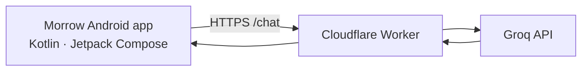

<!--
Morrow project README.
Keep feature status accurate: planned features must not be described as shipped.
-->

### A calmer space to think, create, and explore with AI.

A native Android AI assistant built with **Kotlin** and **Jetpack Compose**, backed by a Cloudflare Worker and Groq.

[Source code](https://github.com/prasunmukherjeeee28-ops/Morrow) · [Issues](https://github.com/prasunmukherjeeee28-ops/Morrow/issues) · [Builds](https://github.com/prasunmukherjeeee28-ops/Morrow/actions)

---

## ✦ What is Morrow?

Morrow is an Android-first AI chat app focused on a polished, thoughtful conversation experience. The project combines a native Compose interface with a small server-side API layer, keeping provider credentials out of the Android client.

> **Project status:** Morrow is a work in progress. Some features and authentication flows are still under development. Check the current code and build results before relying on any feature.

## ✨ Highlights

- **Native Android UI** — Kotlin and Jetpack Compose.
- **Conversation experience** — a custom chat screen with Markdown-style responses and message actions.
- **AI backend** — chat requests are routed through a Cloudflare Worker to Groq.
- **Thoughtful interaction** — the app includes response controls and read-aloud support.
- **Build automation** — GitHub Actions builds the Android project.

Feature availability can change as development continues. Google sign-in and real email-code verification are not considered complete until the app and server flow have been implemented and tested end to end.

## 🧱 Architecture

The Android app calls the Worker rather than embedding the Groq API key in the APK. Keep provider credentials in Cloudflare Worker secrets.

## 🛠️ Tech stack

| Layer | Technology |
| --- | --- |
| Android app | Kotlin |
| UI | Jetpack Compose |
| Backend gateway | Cloudflare Workers |
| AI provider | Groq API |
| Build automation | GitHub Actions |

## 🚀 Getting started

### Try a build

1. Open [GitHub Actions](https://github.com/prasunmukherjeeee28-ops/Morrow/actions).
2. Open a successful run of the Android build workflow.
3. Download the APK artifact if one is available for that run.
4. Install it on a compatible Android device, allowing installation from that source if Android asks.

Only install APKs you trust. An Actions artifact is a development build unless a release is explicitly published and documented.

### Build from source

You'll need Android Studio or a compatible Gradle environment with a JDK supported by the project.

1. Clone this repository.
2. Open the project in Android Studio.
3. Let Gradle sync.
4. Run the app on an emulator or Android device.

The exact build configuration lives in the Gradle files and the workflow under `.github/workflows/`.

## ⚙️ Backend configuration

The Android app currently uses the Morrow Cloudflare Worker chat endpoint:

`https://morrow-backend.prasunmukherjeeee28.workers.dev/chat`

The Worker uses the `GROQ_API_KEY` secret for provider access. Configure secrets in Cloudflare; **never commit API keys, access tokens, signing keys, or private credentials** to this repository.

Authentication is a separate workstream. Do not treat demo email-code flows or placeholder Google buttons as real authentication.

## 🗺️ Roadmap

- [x] Native Kotlin / Jetpack Compose app foundation
- [x] Cloudflare Worker → Groq chat architecture
- [x] GitHub Actions Android build workflow
- [ ] Complete and test real Google sign-in
- [ ] Complete server-verified email-code authentication
- [ ] Document release signing and verified APK releases
- [ ] Add current screenshots and a feature-status checklist

Roadmap checkboxes should only be marked complete when the corresponding behavior has been verified.

## 🤝 Contributing

Issues, bug reports, and focused pull requests are welcome. Please read [CONTRIBUTING.md](CONTRIBUTING.md) before making changes. Keep changes scoped, test the Android build, and avoid including secrets or personal data.

## 🔐 Security

If you discover a security issue, please do not publish secrets or sensitive user data in an issue. See [SECURITY.md](SECURITY.md).

## 📄 License

No license file is currently included. Until a license is added by the project owner, assume standard copyright applies; do not assume the code is open for reuse or redistribution.

---

**Morrow** · Built in the open, one step at a time.

