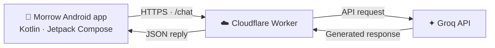

<!-- Morrow README: premium project overview. Keep status accurate; do not claim unfinished auth is shipped. -->

<div align="center">


<br/>

[](https://github.com/prasunmukherjeeee28-ops/Morrow/actions/workflows/build-apk.yml)
[](https://kotlinlang.org/)
[](https://developer.android.com/compose)
[](https://www.android.com/)

# MORROW AI

### Your ideas, in motion.

**A native Android AI companion built for clear conversations, thoughtful interactions, and a polished mobile experience.**

[Explore the code](https://github.com/prasunmukherjeeee28-ops/Morrow) · [Get a build](https://github.com/prasunmukherjeeee28-ops/Morrow/actions) · [Report an issue](https://github.com/prasunmukherjeeee28-ops/Morrow/issues)

</div>

---

> [!NOTE]
> **Active development:** Morrow is a work in progress. Features and setup may change. Google sign-in and production-grade email verification should be considered unfinished until their complete app-to-server flows are implemented and verified.

## ◈ The idea

Morrow brings an AI chat experience to Android through a **Kotlin + Jetpack Compose** client and a lightweight **Cloudflare Worker** gateway connected to **Groq**. The client talks to the backend instead of bundling the provider secret into the APK.

The goal is simple: a focused, modern chat experience that can keep getting better without turning the app into a maze of screens and settings.

## ✦ Experience

<table>
<tr>
<td width="50%" valign="top">

### 💬 Conversation-first UI
A purpose-built Android chat screen with Markdown-style responses and message actions.

</td>
<td width="50%" valign="top">

### ⚡ AI through a gateway
Requests pass through a Cloudflare Worker to the configured Groq API.

</td>
</tr>
<tr>
<td width="50%" valign="top">

### 🎧 Helpful interactions
The app includes response controls and read-aloud support.

</td>
<td width="50%" valign="top">

### 🧩 Native Android foundation
Built with Kotlin and Jetpack Compose, with GitHub Actions automating Android builds.

</td>
</tr>
</table>

> Feature availability can change while development continues. This overview describes the project direction and current implementation, not a guarantee that every planned feature is finished.

## ◉ System architecture



**Security boundary:** the Android client calls the Worker. Provider credentials belong in Cloudflare Worker secrets, never in source files or the APK.

## 🧬 Technology

| Component | Implementation |
|:--|:--|
| Mobile client | Kotlin |
| UI toolkit | Jetpack Compose |
| Backend gateway | Cloudflare Workers |
| AI provider | Groq API |
| CI / APK build | GitHub Actions |

## 🚀 Run Morrow

### Option A — Download a CI build

1. Open **[GitHub Actions → Android build](https://github.com/prasunmukherjeeee28-ops/Morrow/actions/workflows/build-apk.yml)**.
2. Select a successful workflow run on the branch you want to test.
3. Find and download its APK artifact, if the workflow uploaded one.
4. Install it on a compatible Android device. Android may ask you to allow installation from that source.

**Build note:** an Actions artifact is a development build, not automatically a signed public release. Only install builds you trust.

### Option B — Build from source

You'll need Android Studio (or a compatible Gradle environment) and a JDK supported by the project.

1. Clone or download this repository.
2. Open the project in Android Studio.
3. Allow Gradle sync to complete.
4. Run the app on an emulator or connected Android device.

The Gradle configuration and CI workflow are the source of truth for build settings.

## 🔌 Backend setup

The app's configured chat endpoint is:

```text
https://morrow-backend.prasunmukherjeeee28.workers.dev/chat
```

The Worker expects the `GROQ_API_KEY` secret for provider access. Manage that value in Cloudflare's secret configuration.

- Never commit API keys, access tokens, signing keys, or private credentials.
- Keep provider calls behind the Worker rather than placing provider keys in the Android client.
- Demo verification flows and placeholder sign-in controls are **not** production authentication.

## 🗺️ Roadmap

- [x] Native Kotlin / Jetpack Compose app foundation
- [x] Cloudflare Worker → Groq chat architecture
- [x] GitHub Actions Android build workflow
- [ ] Complete and verify Google sign-in end to end
- [ ] Complete server-verified email-code authentication
- [ ] Document release signing and verified APK releases
- [ ] Add current app screenshots and a verified feature checklist

Items should only be marked complete after their behavior has been tested.

## 🧑‍🚀 Contributing

Bug reports, thoughtful suggestions, and focused pull requests are welcome. Start with [CONTRIBUTING.md](CONTRIBUTING.md), keep changes scoped, and test the Android build where possible.

## 🛡️ Security

Please do not publish credentials or sensitive user data in issues. For security guidance, see [SECURITY.md](SECURITY.md).

## ⚖️ License

There is currently no license file in this repository. Until the project owner adds one, standard copyright applies; do not assume reuse or redistribution is permitted.

---

<div align="center">

**MORROW AI**  
*Built in the open. Designed for what comes next.*

</div>
