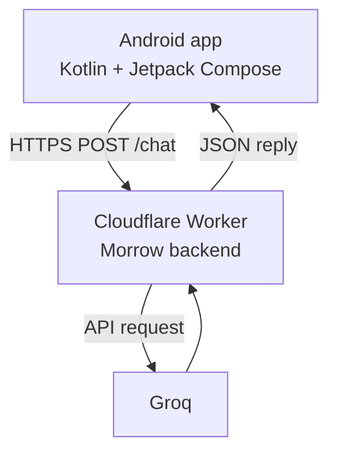

# Morrow architecture

This document describes the known high-level design. It is intentionally limited to behavior established in the repository and current project setup.

## Request path

## Android client

The Android application is implemented in Kotlin with Jetpack Compose. The client owns the conversation interface and sends chat requests to the Worker over HTTPS.

## Worker

The Worker is the server-side gateway to the AI provider. Provider credentials belong in Worker secrets, not in the Android app. The currently configured secret name is `GROQ_API_KEY`.

## Chat API

The Android app uses this endpoint:

`https://morrow-backend.prasunmukherjeeee28.workers.dev/chat`

Keep the request and response contract compatible when changing either side. Confirm the actual deployed Worker code before assuming the exact request schema.

## Authentication status

Google sign-in and real email-code verification require server-side verification and session handling. A UI placeholder or demo code is not proof of real authentication. Document authentication as complete only after end-to-end tests pass.

## Build automation

The repository uses GitHub Actions to build the Android project. Consult the workflow files under `.github/workflows/` for the current build steps and artifact behavior.
